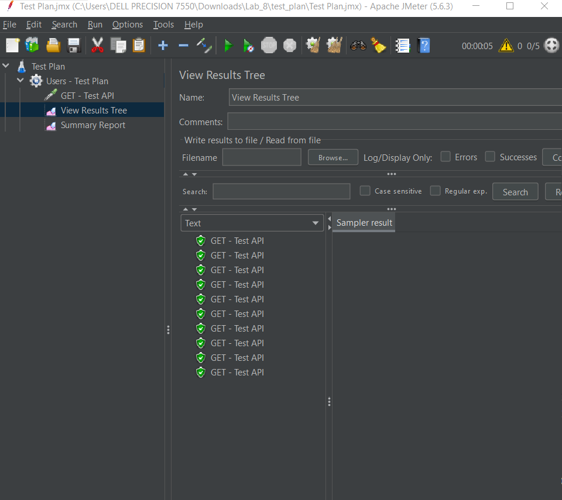
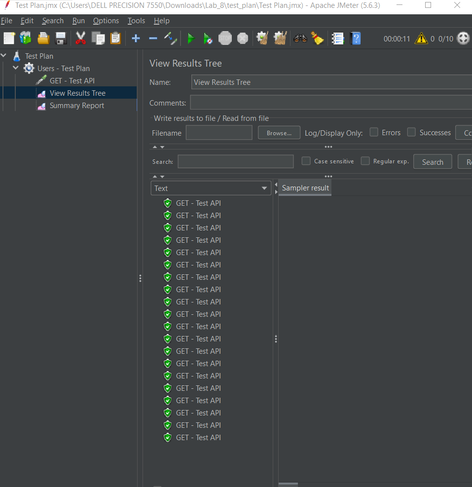
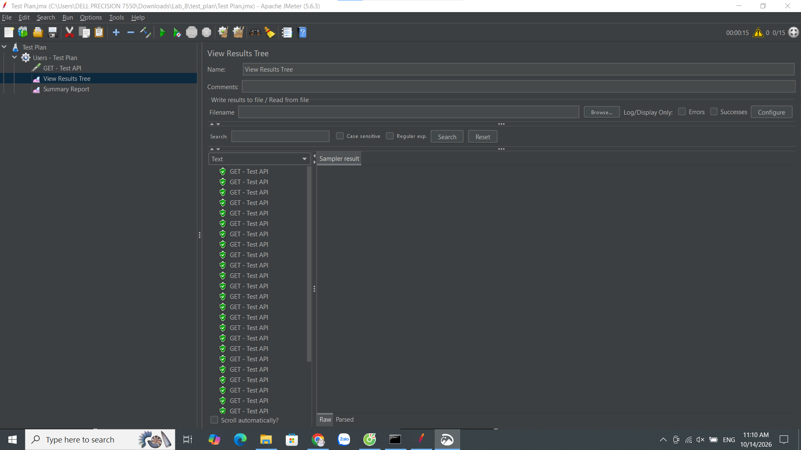
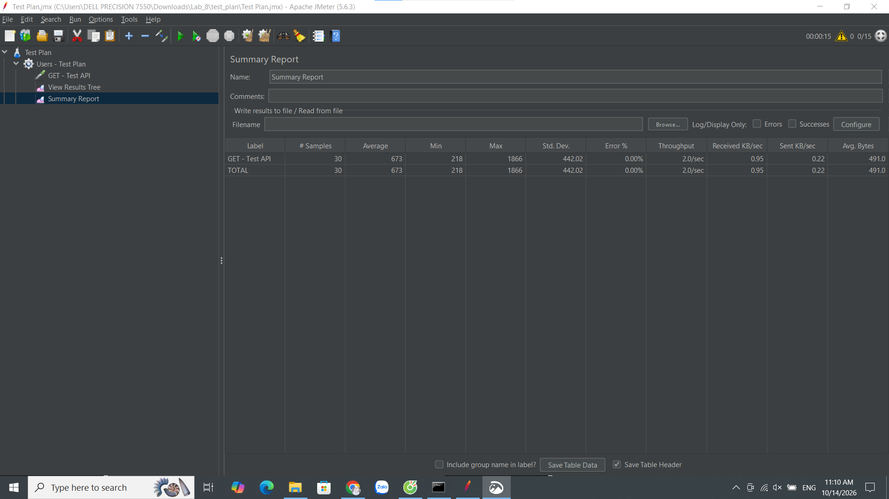

# Lab_8_DGKD
# BÁO CÁO THỰC HÀNH APACHE JMETER
## Kiểm thử hiệu năng API với các mức tải khác nhau

## 1. Giới thiệu

### 1.1. Mục tiêu
Các mục tiêu cụ thể:

- Làm quen với giao diện và các thành phần cơ bản của Apache JMeter.
- Xây dựng kịch bản kiểm thử sử dụng HTTP Request.
- Thực hiện kiểm thử với các mức tải khác nhau bằng Thread Group.
- Theo dõi kết quả từng request và tổng hợp số liệu bằng các Listener.
- So sánh thời gian phản hồi, tỷ lệ lỗi và thông lượng giữa các lần chạy.
- Lưu trữ kịch bản, ảnh minh họa và báo cáo trên GitHub.

### 1.2. Đối tượng kiểm thử
Đối tượng được lựa chọn: [httpbin.org](https://httpbin.org/), một dịch vụ API phục vụ thử nghiệm các yêu cầu HTTP.

- **Endpoint:** `https://httpbin.org/get`
- **Phương thức HTTP:** `GET`

Endpoint `/get` trả về thông tin của yêu cầu HTTP dưới dạng JSON, phù hợp để thực hành gửi request và kiểm tra phản hồi.

### 1.3. Công cụ sử dụng

| Thành phần | Thông tin |
|---|---|
| Công cụ kiểm thử | Apache JMeter 5.6.3 |
| Hệ điều hành | Windows |
| Giao thức | HTTPS |
| Phương thức | GET |
| Định dạng phản hồi | JSON |
| Công cụ lưu trữ mã nguồn | Git và GitHub |

## 2. Cơ sở lý thuyết

### 2.1. Apache JMeter

Apache JMeter là công cụ mã nguồn mở được sử dụng để kiểm thử hiệu năng và đo lường hành vi của ứng dụng, máy chủ và các dịch vụ thông qua những giao thức được hỗ trợ.

Trong bài thực hành này, JMeter được sử dụng để gửi nhiều yêu cầu HTTP đến cùng một endpoint, ghi nhận thời gian phản hồi và tổng hợp kết quả khi số lượng người dùng ảo thay đổi.

### 2.2. Các thành phần trong kịch bản

- **Test Plan:** Quản lý các thành phần và cấu hình của kịch bản kiểm thử.
- **Thread Group:** Cấu hình số lượng người dùng ảo, thời gian khởi động và số vòng lặp.
- **HTTP Request:** Gửi yêu cầu GET đến `https://httpbin.org/get`.
- **View Results Tree:** Hiển thị kết quả từng request, thông tin yêu cầu và nội dung phản hồi.
- **Summary Report:** Tổng hợp thời gian phản hồi, tỷ lệ lỗi và thông lượng.

## 3. Xây dựng kịch bản kiểm thử

### 3.1. Cấu hình HTTP Request

| Tham số | Giá trị |
|---|---|
| Protocol | `https` |
| Server Name or IP | `httpbin.org` |
| Method | `GET` |
| Path | `/get` |

### 3.2. Cấu hình các lần thực nghiệm

Thực hiện ba lần thực nghiệm sử dụng cùng endpoint và số vòng lặp. Số lượng người dùng ảo và thời gian khởi động được thay đổi giữa các lần chạy.

| Thông số | R1 – Tải thấp | R2 – Tải trung bình | R3 – Tải cao hơn |
|---|---:|---:|---:|
| Number of Threads | 5 | 10 | 15 |
| Ramp-up Period (giây) | 5 | 10 | 15 |
| Loop Count | 2 | 2 | 2 |
| Tổng request dự kiến | 10 | 20 | 30 |

Tổng số request dự kiến trong ba lần thực nghiệm là 60. Mỗi người dùng ảo gửi hai request. Ramp-up Period là khoảng thời gian JMeter dùng để khởi động các thread, không phải thời gian phản hồi của một request.

### 3.3. Quy trình thực hiện

1. Khởi chạy Apache JMeter và tạo Test Plan.
2. Thêm Thread Group và cấu hình số người dùng ảo.
3. Thêm HTTP Request với phương thức GET và endpoint đã chọn.
4. Thêm View Results Tree và Summary Report.
5. Chạy thử với 5 người dùng ảo.
6. Tăng số người dùng ảo lên 10 và 15 cho hai lần chạy tiếp theo.
7. Xóa kết quả cũ trước mỗi lần chạy để tránh trộn lẫn số liệu.
8. Ghi nhận kết quả và chụp ảnh minh họa.

### 3.4. Kịch bản JMeter

File kịch bản được lưu tại [`test_plan/Test Plan.jmx`](test_plan/Test%20Plan.jmx).

## 4. Kết quả thực nghiệm

### 4.1. Thực nghiệm R1 – 5 người dùng ảo

**Cấu hình:** 5 threads, ramp-up 5 giây, loop count 2; dự kiến 10 request.

#### a. View Results Tree



Các request hiển thị biểu tượng trạng thái màu xanh, cho thấy chúng được JMeter ghi nhận là thành công theo tiêu chí kiểm tra hiện tại.

#### b. Summary Report


| Chỉ số | Giá trị |
|---|---:|
| Tổng số request | 10 |
| Average Response Time | 719 ms |
| Min Response Time | 219 ms |
| Max Response Time | 1572 ms |
| Standard Deviation | 456,25 ms |
| Error Rate | 0,00% |
| Throughput | 2,0 request/giây |

**Nhận xét:** Ở mức tải thấp, JMeter gửi đủ 10 request theo cấu hình. Thời gian phản hồi trung bình là 719 ms, trong khi thời gian phản hồi lớn nhất là 1572 ms. Độ lệch chuẩn 456,25 ms cho thấy thời gian phản hồi có sự biến động giữa các request.

### 4.2. Thực nghiệm R2 – 10 người dùng ảo

**Cấu hình:** 10 threads, ramp-up 10 giây, loop count 2; dự kiến 20 request.

#### a. View Results Tree



Danh sách kết quả thể hiện 20 request. Các request quan sát được có biểu tượng trạng thái màu xanh.

#### b. Summary Report


| Chỉ số | Giá trị |
|---|---:|
| Tổng số request | 20 |
| Average Response Time | 988 ms |
| Min Response Time | 217 ms |
| Max Response Time | 2237 ms |
| Error Rate | 0,00%* |
| Throughput | Chưa xác nhận từ ảnh hiện có |

**Nhận xét:** Khi tăng số người dùng ảo từ 5 lên 10, thời gian phản hồi trung bình tăng từ 719 ms lên 988 ms, tương đương khoảng 37,4%. Thời gian phản hồi lớn nhất cũng tăng từ 1572 ms lên 2237 ms. Tuy nhiên, chưa thể kết luận sự gia tăng này hoàn toàn do số lượng người dùng ảo, vì kết quả còn chịu ảnh hưởng của độ trễ mạng và trạng thái máy chủ.

### 4.3. Thực nghiệm R3 – 15 người dùng ảo

**Cấu hình:** 15 threads, ramp-up 15 giây, loop count 2; dự kiến 30 request.

#### a. View Results Tree



Danh sách kết quả thể hiện 30 request được thực thi. Các request quan sát được có biểu tượng trạng thái màu xanh.

#### b. Summary Report



| Chỉ số | Giá trị |
|---|---:|
| Tổng số request | 30 |
| Average Response Time | 673 ms |
| Min Response Time | 218 ms |
| Max Response Time | 1866 ms |
| Standard Deviation | 442,02 ms |
| Error Rate | 0,00% |
| Throughput | 2,0 request/giây |

**Nhận xét:** Ở mức 15 người dùng ảo, JMeter ghi nhận 30 request và thời gian phản hồi trung bình 673 ms. Giá trị này thấp hơn R1 và R2. Thời gian phản hồi lớn nhất là 1866 ms, thấp hơn mức 2237 ms của R2. Kết quả cho thấy thời gian phản hồi không tăng đều theo số lượng người dùng ảo trong ba lần thực nghiệm.

## 5. So sánh và phân tích kết quả

### 5.1. Bảng tổng hợp

| Chỉ số | R1 – 5 users | R2 – 10 users | R3 – 15 users |
|---|---:|---:|---:|
| Tổng request | 10 | 20 | 30 |
| Average (ms) | 719 | 988 | 673 |
| Min (ms) | 219 | 217 | 218 |
| Max (ms) | 1572 | 2237 | 1866 |
| Standard Deviation (ms) | 456,25 | Chưa ghi nhận | 442,02 |
| Error Rate (%) | 0,00 | Cần xác nhận | 0,00 |
| Throughput (request/giây) | 2,0 | Chưa xác nhận | 2,0 |

### 5.2. So sánh thời gian phản hồi trung bình


Thời gian phản hồi trung bình giữa ba lần chạy:

- **R1:** 719 ms.
- **R2:** 988 ms.
- **R3:** 673 ms.

R2 có thời gian phản hồi trung bình cao nhất, tăng khoảng 37,4% so với R1. R3 có thời gian phản hồi trung bình thấp nhất, giảm khoảng 31,9% so với R2.

Do đó, dữ liệu không thể hiện xu hướng tăng đều của Average Response Time khi tăng số người dùng ảo.

### 5.3. So sánh thời gian phản hồi nhỏ nhất và lớn nhất

Giá trị Min dao động từ 217 đến 219 ms, tương đối ổn định giữa ba lần chạy.

Giá trị Max thay đổi đáng kể:

- R1: 1572 ms.
- R2: 2237 ms.
- R3: 1866 ms.

R2 có giá trị Max cao nhất, nghĩa là trong lần chạy này có ít nhất một request mất nhiều thời gian hơn đáng kể so với các request nhanh nhất. Min và Max chỉ phản ánh hai giá trị biên; khi đánh giá hiệu năng thực tế, nên xem xét thêm p90 hoặc p95 và thực hiện nhiều lần lặp.

### 5.4. Đánh giá tỷ lệ lỗi

Các ảnh View Results Tree cho thấy các request quan sát được có trạng thái thành công. Summary Report của R1 và R3 ghi nhận Error Rate bằng 0,00%. Đối với R2, cần kiểm tra lại cột Error % trong Summary Report đầy đủ để xác nhận số liệu.

### 5.5. Đánh giá Throughput

Throughput thể hiện số request được xử lý trung bình trong một đơn vị thời gian, thường là request/giây. R1 và R3 ghi nhận Throughput là 2,0 request/giây; chưa có đủ dữ liệu hiển thị để xác nhận giá trị R2.

Throughput phụ thuộc vào tổng thời gian thực thi, thời gian phản hồi và cách JMeter phát request. Không thể chỉ dựa vào số lượng người dùng ảo để suy ra Throughput sẽ tăng tương ứng.

### 5.6. Các yếu tố ảnh hưởng

Kết quả có thể chịu ảnh hưởng bởi:

- Độ trễ và độ ổn định của kết nối Internet.
- Tình trạng hoạt động và tải hiện tại của máy chủ httpbin.org.
- Thời điểm thực hiện các lần chạy.
- Số lượng request còn nhỏ và mỗi mức tải mới chỉ được thực hiện một lần.
- Chi phí khởi tạo kết nối, xử lý HTTPS và các yếu tố môi trường khác.

Vì vậy, kết quả chỉ phản ánh quan sát trong phạm vi thực nghiệm đã tiến hành, không đại diện cho giới hạn chịu tải tối đa của httpbin.org.

## 6. Kết luận

Ba lần thực nghiệm ghi nhận thời gian phản hồi trung bình lần lượt là 719 ms, 988 ms và 673 ms tương ứng với 5, 10 và 15 người dùng ảo. Kết quả không cho thấy mối quan hệ tăng đều giữa số lượng người dùng ảo và thời gian phản hồi.


## 7. Cấu trúc repository

```text
Lab_8_DGKD/
├── README.md
├── anh/
│   ├── R1/
│   │   ├── kq_01.png
│   │   ├── kq_02.png
│   │   └── mt_1.png
│   ├── R2/
│   │   ├── kq_2_01.png
│   │   ├── kq_2_02.png
│   │   └── mt_1.png
│   ├── R3/
│   │   ├── kq_3_01.png
│   │   ├── kq_3_02.png
│   │   └── mt_3.png
│   └── thong_tin.png
└── test_plan/
    └── Test Plan.jmx
```

- `README.md`: Báo cáo thực hành và phân tích kết quả.
- `anh/R1/`, `anh/R2/`, `anh/R3/`: Ảnh cấu hình và kết quả từng lần chạy.
- `anh/thong_tin.png`: Ảnh tổng hợp thông tin thực nghiệm.
- `test_plan/Test Plan.jmx`: File kịch bản kiểm thử JMeter.

## 8. Tài liệu tham khảo

1. Apache JMeter – Official Website: https://jmeter.apache.org/
2. Apache JMeter – User Manual: https://jmeter.apache.org/usermanual/
3. httpbin.org: https://httpbin.org/
